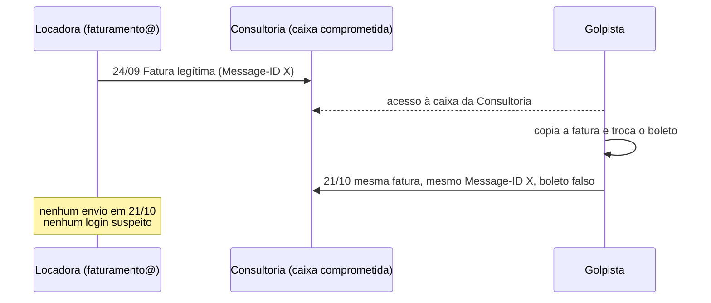

# Caso: boleto adulterado enviado "em nome" do cliente

Investigação de um golpe de boleto por e-mail que atendi no estágio. Um cliente achou que a conta de faturamento dele tinha sido invadida. Os logs mostraram outra coisa.

Nomes, domínios, valores, CNPJs e IPs deste repositório são fictícios. A sequência da investigação e o raciocínio são os do caso real.

## O que aconteceu

A empresa (aqui chamada de **Locadora**) emite faturas por e-mail. Um cliente dela (aqui, **Consultoria**) recebeu uma fatura que parecia legítima: remetente da Locadora, mesmo número de documento, mesmo valor, mesmo vencimento. O boleto anexo era diferente do original.

A Locadora chamou a gente achando que alguém tinha invadido o `faturamento@` e estava mandando boleto falso pros clientes.

## Como foi a investigação

### 1. Comparar os dois boletos

Peguei o boleto do e-mail original e o da versão que a Consultoria recebeu depois e comparei campo a campo.

| | Original | Recebido depois |
|---|---|---|
| Logo | Itaú | Itaú |
| Código do banco na linha digitável | 341 (Itaú) | **033 (Santander)** |
| CNPJ do beneficiário | o da Locadora | **outro CNPJ** |
| Valor | R$ 1.847,50 | R$ 1.847,50 |
| Vencimento | 20/10/2026 | 20/10/2026 |
| Nº do documento | igual | igual |

O logo diz um banco e o código diz outro. Valor, vencimento e número do documento foram copiados pra passar despercebido. Só por aí já dava pra dizer que o boleto era falso.

O script [`scripts/boleto.py`](scripts/boleto.py) faz essa conferência pela linha digitável:

```
$ python scripts/boleto.py --comparar "34191.79001 10435.100473 91020.150008 9 16050000184750" \
                                      "03399.57318 02881.300004 00007.701014 1 16050000184750"
...
== Suspeito ==
Banco:       033 (Santander)
ALERTA:      O código é do banco 033 (Santander), mas o esperado era 341 (Itaú).

== Diferenças ==
banco: 341  ->  033
campo_livre: 1790010435100479102015000  ->  9573102881300000000770101
```

Os dígitos verificadores do boleto falso estão corretos. Isso é importante: o golpista gerou um boleto válido num banco de verdade. Conferir só o DV não pega esse golpe. O que denuncia é o banco e o beneficiário não baterem com quem está cobrando.

### 2. Ver se a mensagem saiu mesmo da conta da Locadora

No Google Workspace, a pesquisa de registros de e-mail (Email Log Search) mostra todo envio que passou pelo domínio. Procurei pelo assunto da fatura e pelo destinatário.

Resultado ([exemplo fictício](evidencias/email-log-search.csv)): a fatura foi enviada **uma vez**, em 24/09, pelo servidor da Locadora. No dia 21/10, quando a versão falsa chegou na Consultoria, não existe nenhum envio dessa mensagem saindo do domínio.

### 3. Conferir os logins da conta de faturamento

No relatório de logins do Admin Console, filtrei a conta `faturamento@` no período de 07/10 a 23/10.

Todos os acessos vieram do IP da rede da empresa, sem login de outro país, sem falha de senha em sequência e sem sessão de dispositivo desconhecido ([exemplo fictício](evidencias/logins-faturamento.csv)).

### 4. O detalhe que fechou o caso

O e-mail falso tinha o **mesmo Message-ID** do e-mail original.

O Message-ID é gerado pelo servidor que envia a mensagem. Se o golpista tivesse escrito um e-mail novo, mesmo se passando pela Locadora, o identificador seria outro. Sendo igual, alguém pegou a mensagem verdadeira, que só existia na caixa de quem recebeu, trocou o anexo e reenviou.

O campo "De:" de um e-mail pode ser preenchido com qualquer endereço. Ele aparecer como `faturamento@locadora` não prova que a mensagem saiu de lá.

## Conclusão



- A conta da Locadora não foi invadida.
- O boleto de 21/10 é falso.
- O comprometimento está numa caixa de e-mail do lado da Consultoria.

## O que recomendei

**Pra Consultoria** (a Locadora repassou):
- não pagar o boleto de 21/10;
- trocar na hora a senha das caixas que receberam a fatura e ativar a verificação em duas etapas;
- confirmar por telefone qualquer boleto com dado diferente antes de pagar.

**Pra Locadora**, mesmo sem sinal de invasão:
- 2FA obrigatório pelo menos em faturamento, financeiro, administrativo e diretoria;
- senhas com 12 caracteres ou mais, sem reaproveitar de outros sites;
- avisar os clientes, no corpo da fatura e por telefone, que a empresa não muda de banco nem de CNPJ por e-mail.

## O que fica de lição

- Antes de concluir "fomos invadidos", olha os logs de envio e de login. Eles respondem em minutos.
- Message-ID repetido é sinal de que a mensagem foi copiada de alguma caixa, não forjada do zero.
- Golpe de boleto mira quem paga e quem cobra. 2FA nas contas financeiras é o mínimo.

## Ferramentas usadas

- Admin Console do Google Workspace: pesquisa de registros de e-mail e relatório de logins
- Google Admin Toolbox (Messageheader) pra ler os cabeçalhos da mensagem
- Uma integração que montei ligando o Claude ao console de parceiro do Google, pra cruzar os registros mais rápido

## Arquivos

- [`playbook.md`](playbook.md): checklist reaproveitável pra esse tipo de chamado
- [`scripts/boleto.py`](scripts/boleto.py): lê e confere a linha digitável, compara dois boletos
- [`evidencias/`](evidencias/): exemplos fictícios de como os registros aparecem

Rodar os testes:

```
cd scripts
python -m unittest -v
```
